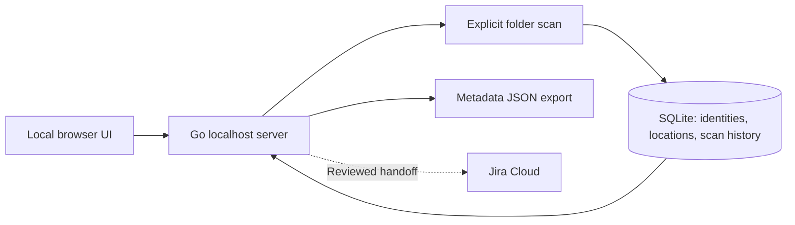

# CredDrift

Local credential discovery and evidence tracking, built with **Go and SQLite**. Distinguish a candidate removed from checked source from one whose location was simply not checked.

- Detects AWS access key IDs, classic GitHub tokens, and `api_key` / `password` assignments.
- Groups repeated values by SHA-256 identity while preserving file and line locations.
- Records an evidence timeline: new, still present, reappeared, absent from checked coverage, or unverified with coverage reasons.
- Commits scan history and reconciliation together; failed or cancelled scans retain earlier evidence.
- Supports ignore/restore, metadata JSON export, and optional Jira handoff with duplicate-create protection.

## Run

Download and extract a [portable release](https://github.com/theprideofwolves/creddrift/releases), then run `creddrift.exe` (Windows) or `./creddrift` (Linux). The app opens a private localhost UI. Choose **Try the guided demo** for an offline example; no account or API key is needed.

From source, with Go **1.25.5+**:

```sh
go run .
```

Choose a folder or paste its absolute path, then explicitly scan. Setup checks do not scan files. Stop the app with **Ctrl+C** in the launcher; closing the browser leaves it running. Light and black dark themes share a green accent.

## Architecture



The server binds only to loopback and guards requests with a per-launch token, Host/Origin checks, and CSP. Only complete scans update occurrence state in a database transaction.

History records observations, not proof of file movement or provider remediation. Timeline JSON exports the latest 100 attempts and can filter events by identity.

## Boundaries

Candidate values are transient and are excluded from findings, exports, and SQLite. Paths and unsalted hashes remain sensitive; weak values can be guessed from hashes. Matches and entropy do not prove validity. Rotation recording is a manual user action.

No provider validation, automatic rotation, telemetry, or Git-history scanning. Default exclusions: `.git`, `node_modules`, `vendor`, `CredDrift`, symlinks, and binary files. Limits: 50,000 files, 32 MiB/file, 1 MiB/line, 100,000 matches. Excluded and out-of-scope evidence is retained.

Data lives in the OS configuration directory under `CredDrift`. `CREDDRIFT_DATA_DIR` overrides its parent; any nonempty `CREDDRIFT_NO_BROWSER` disables browser opening.

## Verify

```sh
go test -race -count=1 ./...
go vet ./...
go build -o creddrift .
python .github/scripts/smoke.py ./creddrift
```

Use `creddrift.exe` on Windows. Tests use synthetic folders and local Jira mocks; live Jira compatibility requires separate testing.

[Interview walkthrough](interviewprep.md) · [Manual checklist](TESTING.md) · [Coverage and limits](spec.md) · [Implementation](architecture.md) · [Data, upgrades and Jira details](OPERATIONS.md)
