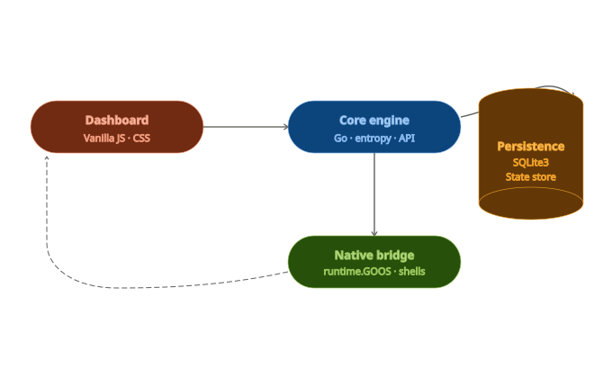

# CredDrift
### Local secret discovery and finding triage
Go security automation tool that scans local source files for potential credentials, tracks their locations in SQLite, and provides a web dashboard for reviewing findings.

## What I built
- Pattern matching for AWS access key IDs, GitHub classic personal access tokens, and `api_key` / `password` assignments, with file and line locations.
- Shannon entropy scoring for matches; generic values with entropy at or below 3.5 are labeled `Weak_Secret`.
- SHA-256 credential identities and SQLite records linking the same potential secret to multiple locations.
- Dashboard actions to ignore findings, restore them, and record a manual rotation timestamp.

## Workflow
`config.yaml -> filesystem scan -> pattern matching and entropy -> SQLite -> dashboard`



## Run locally
Requires Go 1.25.5 or newer, matching `go.mod`. The project uses a Go SQLite driver; a separate SQLite server is not required.

```bash
git clone https://github.com/theprideofwolves/creddrift.git
cd creddrift
go mod download
go build -o creddrift .
```

Edit `config.yaml` to choose scan targets and ignored directories, then run the binary from the repository directory. On Windows, run `.\creddrift.exe` after building with `-o creddrift.exe`; on macOS/Linux, run `./creddrift`. Open [the dashboard](http://localhost:8080).

The application scans configured targets at startup. Selecting a path in the dashboard triggers another scan.

## Implementation
| Component | Responsibility |
| --- | --- |
| `scanner/` | Directory traversal, binary-file skipping, matching, entropy |
| `internal/store/` | Credential hashes, locations, ignore state, rotation timestamps |
| `internal/ui/` | Embedded dashboard and HTTP actions |
| `config/` | YAML configuration |

## Current scope
Findings are candidates for review; the tool does not validate credentials with providers or rotate them automatically. Entropy scores describe matched strings rather than proving a credential is valid. Scan records use hashes rather than storing raw secret values in SQLite. Some dashboard queries hide records not seen within five minutes; this is not continuous background monitoring.

This is a local development tool. The HTTP listener currently binds to `:8080` without authentication, so restrict network access to the host while using it. Native folder selection requires the relevant desktop utilities.

## Resume bullets
- Built a Go secret-discovery tool that identifies potential AWS keys, GitHub tokens, and hardcoded credentials using pattern matching and Shannon entropy scoring, with file and line locations.
- Implemented SHA-256 credential identities, SQLite location tracking, and a web dashboard to ignore, restore, and record manual rotation status for findings.
