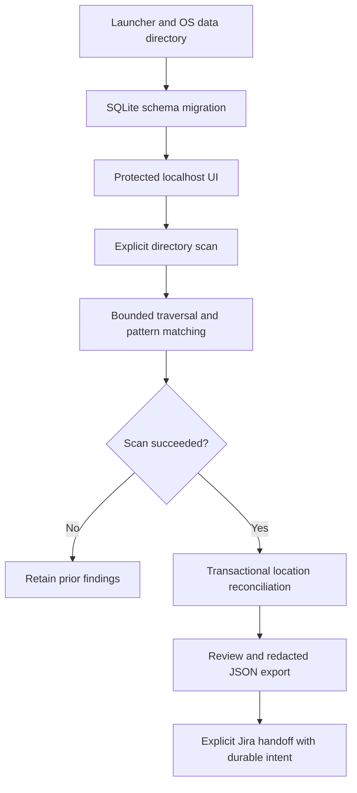

# CredDrift: implemented architecture

## Source map

- main.go opens the user-data database and declares default exclusions. Config
  holds in-memory scan targets; no YAML file is read and no startup scan runs.
- internal/desktop launches loopback HTTP with a random token/port, host/origin
  guards, CSP and one data-directory launcher lock.
- internal/onboarding provides demo/own-folder selection, native picker with
  manual fallback, readability check and optional read-only Jira identity check.
  Setup never scans; selected paths remain in session memory only.
- internal/ui/server.go serializes scans and review actions through a mutex.
  The scanner gets a cooperative three-minute deadline. A failed scan never
  calls Reconcile. Complete guide progress is saved only after reconciliation.
- scanner/scanner.go traverses explicit targets, applies exclusions, matches
  supported patterns and calculates entropy. No provider API validates a match.
- internal/store/store.go uses one SQLite connection, migrates manual-action
  timestamps, hashes candidate values, and reconciles covered locations in a
  transaction. Ignoring a hash applies across its locations. Exports are metadata.
- internal/ticket stores create intent and delivery mappings separately in
  tickets.json; it handles uncertain responses without blind automatic retries.

## State and boundaries

creddrift.db stores candidates, occurrences and review actions. onboarding.json
contains a version/completion flag. Demo source lives under synthetic-demo and
uses the same database as real scans; it does not clear existing findings.
Restarting the guide never resets the database. Jira credentials are request-only.
Candidate strings exist transiently during scanning; hashes are not encryption.

This is a local single-user tool. No network deployment, shared authentication,
provider rotation, continuous monitoring or enterprise deployment is established.
Scopes are observations of a changing filesystem, not an atomic filesystem snapshot.
Tests cover state transitions, redaction, reconciliation failures, local request
guards, mocked Jira contracts and packaged launch/demo/export/restart flows.
Live Jira permissions and native-picker behavior require separate validation.

## Evidence timeline

`internal/store/timeline.go` stores scan_history and evidence_events. Reconcile snapshots occurrence activity within its transaction; the after-state determines new/still present/reappeared/absent/unverified events. Timeline insertion and occurrence reconciliation share one commit. Failed/cancelled scanner runs skip reconciliation and record only an incomplete attempt. Reconciliation failures roll back both state and timeline; the UI records a failed attempt separately.

The UI links each candidate identity to its timeline; /timeline and /export?view=timeline support optional hash filtering. Queries show the latest 100 attempts with deterministic event ordering. Existing data migrates additively; no past scan history is fabricated. No raw values or source snippets are added to history. Out-of-scope evidence is labeled without scanning that source. New paths are observations, never inferred file moves. Manual actions remain separate from source evidence and provider remediation stays unverified.
